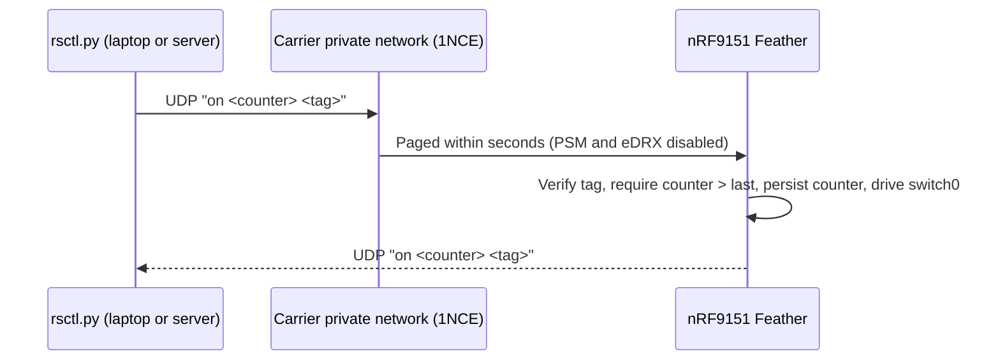

<!-- SPDX-License-Identifier: MIT -->

# Remote Switch (`remote_switch`)

Zephyr RTOS + Rust (`zephyr-lang-rust` / Embassy) firmware application for driving a physical relay or MOSFET switch output on the **Circuit Dojo nRF9151 Feather** (`circuitdojo_feather_nrf9151/nrf9151/ns`) with Trusted Firmware-M (TF-M) and MCUboot sysbuild support.

## Overview

- **Async Rust Switch Controller (`src/lib.rs`)**: Runs an Embassy executor task (`switch_controller`) on Zephyr that owns the `switch0` GPIO pin, confirms MCUboot test-swap images after safe `OFF` initialization, and processes `SwitchCommand` events (`Toggle`, `Set(bool)`) from a bounded lock-free `Channel<CriticalSectionRawMutex, SwitchCommand, 8>` with atomic dropped-command accounting.
- **Authenticated Remote Control (`src/protocol.rs`, `src/remote.rs`)**: Verifies one-line text commands (`on` / `off` / `status`) with a truncated HMAC-SHA256 tag and a monotonic counter that is persisted to flash for replay protection, then replies with an authenticated status. The handler does not depend on the transport, so UDP and the debug shell share the same code path.
- **Low-Data Cellular Transport (`src/cellular.c`)**: Attaches over LTE-M (NB-IoT fallback) with an IPv4-only PDN and serves commands on a UDP port. It sends nothing while idle and one ~60-byte reply per authenticated command. Unauthenticated datagrams are dropped without a reply. See [Remote Control over Cellular](#remote-control-over-cellular).
- **C Board I/O Shim (`src/board_io.h`, `src/board_io.c`)**: Bridges debounced local button events (`aliases::sw0` via Zephyr's `input` subsystem) into Rust, drives the onboard nPM1300 PMIC host status LED (`npm1300_leds` channel 2 over I2C), provides runtime MCUboot image confirmation (`board_confirm_image()`), and persists the replay counter with Zephyr settings on NVS (`storage_partition`).
- **Host CLI (`tools/rsctl.py`)**: Generates the key, signs commands, and sends them over UDP, verifying the authenticated reply. Uses only the Python standard library.
- **Non-Secure Partitioning & Bootloader (`sysbuild.conf`, `sysbuild/mcuboot.conf`, `sysbuild/remote_switch.conf`)**: Builds with Zephyr Sysbuild, pairing MCUboot (`64 KB`) with TF-M secure firmware (`256 KB`) and the non-secure Rust/C application (`192 KB` slot, with MCUboot DFU image confirmation configured for sysbuild targets).

## Hardware & Pin Mapping

Default peripheral assignments on `circuitdojo_feather_nrf9151/nrf9151/ns`:

| Function | Devicetree Node / Alias | Default Pin / Bus | Notes |
| --- | --- | --- | --- |
| Switch actuator output | `aliases::switch0` (`&switch_out`) | Header **`D2`** (`P0.26`, `GPIO_ACTIVE_HIGH`) | Configured in `boards/circuitdojo_feather_nrf9151_ns.overlay` |
| Local toggle button | `aliases::sw0` (`&button0`) | Onboard **`MODE`** button (`P0.03`) | Debounced `gpio-keys` input (`INPUT_KEY_0`) |
| Status indicator LED | `npm1300_leds` (channel `2`) | `i2c2` (`P0.02` SDA / `P0.01` SCL) | nPM1300 PMIC host-controlled blue LED |
| Console & MCUmgr UART | `zephyr,console` (`&uart0`) | `P0.11` TX / `P0.10` RX (`115200 8N1`) | Serial logs, debug shell, and MCUboot serial recovery |
| Cellular modem | nano-SIM slot + U.FL antenna | LTE-M (NB-IoT fallback) | Attach the LTE antenna before powering the modem |

### Hardware Fail-Safe & Load Isolation

> **Important:** nRF9151 GPIO pins remain in a high-impedance (floating) state during power-on reset, MCUboot execution, TF-M startup, and early kernel initialization until `switch_controller` configures `switch0` as `ZR_GPIO_OUTPUT_INACTIVE`.
>
> - **External Pull Resistor:** Always fit an external pull-down resistor (for example, `10 kOhm` to `GND` for `GPIO_ACTIVE_HIGH` MOSFET/relay stages, or a pull-up resistor to `VDD` for `GPIO_ACTIVE_LOW` stages) on the actuator control input so the switched load cannot glitch `ON` during reset or firmware updates.
> - **Driver Stage:** Do not drive inductive relay coils directly from an nRF9151 GPIO pin. Use a logic-level MOSFET or transistor buffer, flyback diode, and appropriate galvanic isolation rated for the target load.

### Customizing the Switch Output Pin

Edit `boards/circuitdojo_feather_nrf9151_ns.overlay` (or pass an extra gitignored overlay via `-- -DEXTRA_DTC_OVERLAY_FILE=boards/circuitdojo_feather_nrf9151_ns.local.overlay`, or replace the default board overlay via `-- -DDTC_OVERLAY_FILE=boards/circuitdojo_feather_nrf9151_ns.local.overlay`) to change `&gpio0 26` or switch between `GPIO_ACTIVE_HIGH` and `GPIO_ACTIVE_LOW`.

The `outputs` node uses `compatible = "gpio-leds"` so `zephyr-lang-rust` (`dt-rust.yaml`) generates a typed `GpioPin` accessor for `aliases::switch0`. `CONFIG_LED_GPIO=n` is set in `boards/circuitdojo_feather_nrf9151_ns.conf` so Zephyr's C `led_gpio` driver does not contend with Rust for ownership of the pin.

## Prerequisites

1. **Zephyr Dependencies & SDK**:
   - Python 3.10+, `west` (`>= 1.2`), CMake (`>= 3.21`), Ninja, and DeviceTree Compiler (`dtc`).
   - [Zephyr SDK](https://docs.zephyrproject.org/latest/develop/toolchains/zephyr_sdk.html) with the `arm-zephyr-eabi` toolchain installed (`ZEPHYR_SDK_INSTALL_DIR` configured if installed in a non-default location).
2. **Rust Toolchain (`>= 1.85`)**:
   ```sh
   rustup toolchain install stable
   rustup target add thumbv8m.main-none-eabi
   rustup component add clippy rustfmt
   ```

## Workspace Setup

`west.yml` pins both Circuit Dojo's Feather SDK manifest (`nfed` at `79ee909971558cbea852dd668134be6ef73adfe7`) and `zephyr-lang-rust` (`6823b690ed2daf636323cbb8a10447d142752e1f`) to immutable commit hashes for reproducible builds.

### Option A: Initialize from a Remote Git URL

```sh
west init -m <repo-url> remote-switch-workspace
cd remote-switch-workspace
west update
```

### Option B: Initialize from a Local Checkout of `remote_switch`

If you already have the `remote_switch` directory locally, place it inside an empty parent workspace directory and initialize `west` against it:

```sh
mkdir remote-switch-workspace
mv remote_switch remote-switch-workspace/remote_switch
cd remote-switch-workspace
west init -l remote_switch
west update
```

## Building, Testing & Flashing

Run all `west` commands from the parent `remote-switch-workspace` directory.

### Build Firmware (Sysbuild + Clippy)

```sh
west build -b circuitdojo_feather_nrf9151/nrf9151/ns -p -d build --sysbuild remote_switch
```

Every Zephyr build compiles MCUboot, TF-M, C sources, and the Rust static library (`librustapp.a`), and automatically enforces `cargo clippy -- -D warnings -D clippy::undocumented_unsafe_blocks`. If the git-ignored `remote_switch/remote_switch.local.conf` exists, the build merges it automatically. That file holds the remote-control key (see [Setup](#setup)). Without it the firmware still builds and runs, but it drops all remote commands.

> **Tip:** Passing an external build directory (for example, `-d /tmp/remote-switch-build`) keeps `remote_switch/` free of generated CMake/Cargo build artifacts when preparing release archives.

### Run Host Unit Tests & Format Checks

Protocol, replay-protection, state-machine, bounded-queue, drop-counter, and FFI boundary tests run directly on the host target without hardware:

```sh
cargo test --manifest-path remote_switch/Cargo.toml
cargo fmt --manifest-path remote_switch/Cargo.toml -- --check
```

If dependencies are already cached locally, append `--offline` to `cargo test`.

### Validate with Zephyr Twister

```sh
west twister -T remote_switch --build-only -O twister-out
```

### Flash & Monitor Serial Console

Flash the merged sysbuild image over SWD (`probe-rs`, J-Link, or CMSIS-DAP):

```sh
west flash -d build --runner probe-rs
```

Connect a serial terminal to `uart0` at `115200` baud (`8N1`) and press the onboard **MODE** button to toggle `switch0`.

### Optional IDE (`rust-analyzer`) Configuration

During `west build`, `zephyr-lang-rust` generates `<build-dir>/remote_switch/rust/sample-cargo-config.toml`. For local `rust-analyzer` integration, you may copy it to `remote_switch/.cargo/config.toml` (ignored by `.gitignore`). Note that this generated file embeds machine-local absolute paths and should be deleted before packaging source tarballs.

### Path Remapping for Redistributable Binaries

Zephyr strips C `__FILE__` prefixes from loadable binary sections by default (`CONFIG_BUILD_OUTPUT_STRIP_PATHS=y`), whereas Rust panic metadata inside `.bin`, `.hex`, and `dfu_application.zip` embeds workspace and Cargo registry paths unless remapped. Before publishing prebuilt flash or DFU images (`dfu_application.zip`, `zephyr.signed.hex`, `merged.hex`, `zephyr.bin`), remap Rust host paths with `--remap-path-prefix`:

```sh
RUSTFLAGS="--remap-path-prefix=$(pwd)=/workspace --remap-path-prefix=${CARGO_HOME:-$HOME/.cargo}=/cargo" \
  west build -b circuitdojo_feather_nrf9151/nrf9151/ns -p -d build --sysbuild remote_switch
```

(If your workspace or `CARGO_HOME` path contains spaces, pass `0x1f`-separated flags via `CARGO_ENCODED_RUSTFLAGS` instead of space-separated `RUSTFLAGS`.)

> **Note on ELF Debug Sections:** Distribute flashable/DFU payloads (`dfu_application.zip`, `.hex`, `.bin`) rather than unstripped `.elf` outputs (`zephyr.elf`, `tfm_s.elf`). Because `RUSTFLAGS` applies only to `rustc`, unstripped `.elf` files still retain C/ASM compiler and SDK toolchain DWARF debug paths (`.debug_line`, `.debug_str`). If you need to archive or share an `.elf` file, strip DWARF debug sections with `arm-zephyr-eabi-strip --strip-debug` (or pass C `-ffile-prefix-map` flags via `EXTRA_CPPFLAGS` for Zephyr images; note that TF-M's `tfm_s.elf` builds through its own ExternalProject toolchain and still requires `--strip-debug`).

## Remote Control over Cellular

The cellular link is built for IoT SIMs with tiny allowances. The reference setup uses a [1NCE](https://1nce.com) SIM, which includes 500 MB of data and 250 SMS for 10 years.

### How It Works



- The device attaches over LTE-M (NB-IoT fallback) with an IPv4-only PDN on APN `iot.1nce.net`, then waits on UDP port `4242` (`CONFIG_REMOTE_SWITCH_UDP_PORT`).
- The device never starts traffic. It sends no keep-alives, heartbeats, DNS queries, or NTP requests, and the IPv4-only PDN avoids IPv6 router advertisements.
- Every authenticated request gets exactly one authenticated reply. Unauthenticated or malformed datagrams are dropped without a reply, so probes cannot make the device spend data.
- If the PDN is missing for `CONFIG_REMOTE_SWITCH_PDN_RECOVERY_TIMEOUT` seconds (default 300), the firmware re-attaches. The modem library resets the modem after a modem fault.

### Data Budget

| Traffic | Data used |
| --- | --- |
| Idle (attached and listening) | 0 bytes |
| One command and its reply | About 120 bytes: 2 × (20 B IPv4 + 8 B UDP + about 33 B payload) |
| Unauthenticated datagram | Inbound bytes only, no reply |

The carrier may round each data session up (1NCE bills in 1 KB increments). Even so, 500 MB covers hundreds of thousands of commands. The modem counts bytes since boot. The firmware logs this count every 6 hours and after each command (`Data since boot: ...`).

> [!NOTE]
> Commands use UDP rather than SMS. 1NCE only accepts SMS from its portal or API, not from phones, and every SMS received or sent counts against the 250-SMS lifetime quota.

### Setup

1. Generate a device key once. The file is ignored by git (`*.local.conf`), and the build picks it up automatically:
   ```sh
   (umask 077; python3 remote_switch/tools/rsctl.py keygen > remote_switch/remote_switch.local.conf)
   ```
2. Build (see [Build Firmware](#build-firmware-sysbuild--clippy)) and flash.
3. On the serial console, look for `Network: registered (roaming)`, `PDN connection active`, and `Listening for commands on <ip>:4242/udp`. The 1NCE portal also shows the SIM's static IP address.

For other SIM providers, change `CONFIG_LTE_LC_PDN_DEFAULT_APN` in `prj.conf`.

### Sending Commands

The SIM's private IP address can only be reached from inside the carrier network:

- **1NCE OpenVPN (direct UDP, with verified replies):** In the 1NCE portal, set Internet Breakout to manual mode, enable the VPN service, and connect with the downloaded OpenVPN profile. Then run:
  ```sh
  python3 remote_switch/tools/rsctl.py send on --host <SIM IP>
  python3 remote_switch/tools/rsctl.py send status --host <SIM IP>
  ```
  `rsctl.py` retries lost datagrams with the same counter. A retry gets the current state but is not applied again. If the device reports a newer counter (`stale`), the tool resynchronizes once.
- **Other transports:** `rsctl.py payload on` prints a signed one-line message. Any transport that delivers that line as a UDP datagram to port `4242` works, such as a server inside the VPN or a carrier API that sends UDP downlink. The reply goes back to the sender's address.

### Protocol

Requests are `<command> <counter> <tag>`, where `command` is `on`, `off`, or `status`. Replies are `<status> <counter> <tag>`, where `status` is `on`, `off`, `stale`, `unavailable`, or `busy`.

- `tag` is the first 8 bytes (16 hex digits) of `HMAC-SHA256(key, "rs1 req " + "<command> <counter>")`. Replies use the domain prefix `"rs1 rsp "` instead, so a captured reply can never be replayed as a request.
- `counter` is a decimal `u64` that must be larger than every counter accepted before. `rsctl.py` uses Unix time in milliseconds. The last accepted counter is stored in flash, so replay protection survives reboots.
- If a request reuses the last accepted counter (a retry), the device reports the current state without applying it again. If the counter is older, the device replies `stale <last accepted counter>`.

### Debug Shell

The console UART provides a Zephyr shell. You can test the full command path without using cellular data:

```text
uart:~$ rs msg on 1761840000123 16d82a013add92ef   # paste output of `rsctl.py payload on`
on 1761840000123 50d3e76858638e40
uart:~$ at AT%XCONNSTAT?     # SMS sent, SMS received, kB up, kB down, max/avg packet size
uart:~$ at AT%XMONITOR       # registration, operator, band, signal quality
```

## Security Considerations for Production Deployment

1. **Replace the Default MCUboot Signing Key (`SB_CONFIG_BOOT_SIGNATURE_KEY_FILE`)**:
   - Upstream MCUboot defaults to a publicly known debug key (`root-ec-p256.pem`). Because UART0 MCUmgr serial recovery is available on the board, **never deploy firmware signed with the default key**.
   - Generate a dedicated ECDSA-P256 private key at an **absolute path outside the repository and `west` workspace** (`*.pem` and `*.key` in `remote_switch/.gitignore` only guard `remote_switch/`, not the parent workspace, and MCUboot vs. `west sign` resolve relative paths against different base directories). Because `BOOT_SIGNATURE_KEY_FILE` is a Kconfig `string` symbol written into `extra_kconfig_options.conf`, **escape the inner quotes** (`\"...\"`) on the command line (matching `sysbuild.conf`) so your shell preserves literal quotes for Kconfig:
     ```sh
     imgtool keygen -k /secure/path/to/prod-key.pem -t ecdsa-p256
     west build -b circuitdojo_feather_nrf9151/nrf9151/ns -p -d build --sysbuild remote_switch \
       -- -DSB_CONFIG_BOOT_SIGNATURE_KEY_FILE=\"/secure/path/to/prod-key.pem\"
     ```
2. **Enable Hardware Debug Port Protection & Anti-Rollback**:
   - Lock SWD debug access (`-DSB_CONFIG_APPROTECT_LOCK=y -DSB_CONFIG_SECURE_APPROTECT_LOCK=y`) and enable anti-rollback protection: either MCUboot software version anti-rollback (`-Dmcuboot_CONFIG_MCUBOOT_DOWNGRADE_PREVENTION=y` or in `sysbuild/mcuboot.conf`) on the default static Devicetree partition layout, or hardware monotonic-counter downgrade prevention (`-DSB_CONFIG_PARTITION_MANAGER=y -DSB_CONFIG_MCUBOOT_HARDWARE_DOWNGRADE_PREVENTION=y` together with a static `pm_static.yml` and NSIB key, as `circuitdojo_feather_nrf9151` defaults `SB_CONFIG_PARTITION_MANAGER=n`).
3. **Protect the Remote-Control Key**:
   - Every command and reply is authenticated (truncated HMAC-SHA256) and replay-protected by a monotonic counter persisted in flash. Commands are **not encrypted**: on/off state is not secret, and the device is only reachable through the carrier's private network. Add DTLS if your threat model needs confidentiality, at the cost of handshake data.
   - Use a unique key per device and keep `remote_switch.local.conf` private (`chmod 600`, never commit it). The key is compiled into the application image and appears in the build directory's `.config`, so do not share build directories or unencrypted images of deployed devices. Lock the debug port (item 2) so the key cannot be read out over SWD.
   - `rust_handle_remote_message` (declared in `src/board_io.h`) is the only remote entry point, and every transport must pass raw bytes through it. Do not add paths that actuate the switch without it.
4. **Fault Recovery & Watchdog Supervision**:
   - `CONFIG_RESET_ON_FATAL_ERROR=y` resets the SoC immediately upon any kernel fault or Rust panic so `switch0` returns to its inactive (`OFF`) state rather than remaining latched `ON`, and `[profile.release] overflow-checks = true` guards against silent integer wraparound. When integrating network/modem stacks, enable the hardware watchdog (`wdt0` / `CONFIG_WATCHDOG=y`) as an additional liveness backstop.

## License

Licensed under the [MIT License](LICENSE) (`MIT`).
